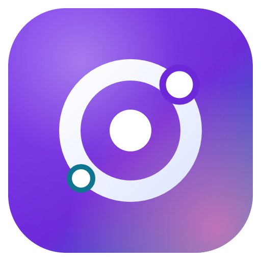

<div align="center">



# Nexo AI

**Tu estudio de IA de escritorio: modelos locales y en la nube, agentes que usan tu PC, MCP, skills, navegador y voz — todo en una sola app.**


[Qué es](#-qué-es-nexo-ai) · [Funciones](#-funciones) · [Instalación](#-instalación) · [Cómo se usa](#-cómo-se-usa) · [Compilar](#-compilar-desde-el-código) · [Estructura](#-estructura-del-proyecto)

</div>

---

## 🧠 ¿Qué es Nexo AI?

Nexo AI es una aplicación de escritorio (Electron) que reúne en un solo lugar lo que normalmente necesitas varias herramientas para hacer:

- **Ejecutar modelos de IA en tu propio PC** (GGUF con `llama.cpp`, CUDA / Vulkan / CPU), sin enviar nada a internet.
- **Usar modelos por API** (Claude, GPT, Gemini, OpenRouter, Groq, DeepSeek…) con la misma interfaz.
- **Agentes que hacen trabajo real**: leen y editan archivos, usan la terminal, controlan ratón y teclado, navegan por la web y delegan tareas en otros agentes.
- **Hablarle por voz**, incluido un modo manos libres estilo **JARVIS**.

Analiza tu hardware y te dice qué modelos van **fluidos**, cuáles **lentos** y cuáles **no caben**, y ajusta solo el contexto y la memoria de cada modelo.

## ✨ Funciones

| Área | Qué hace |
|---|---|
| 🖥️ **Modelos locales** | Catálogo curado (Qwen, Gemma, gpt-oss, GLM, Devstral…), búsqueda en todo Hugging Face y **detección automática de modelos nuevos**. Descargas reanudables, varias cuantizaciones, visión (mmproj), importación de GGUF y carpetas de LM Studio. |
| 📊 **Análisis del equipo** | Detecta CPU, RAM, GPUs y VRAM real; lee la arquitectura de cada GGUF (capas, KV caché, MoE) para estimar memoria y velocidad. **Contexto automático por modelo** y recomendaciones por tarea (Programar, Navegar, Controlar PC, Chat). |
| 🔀 **Multi-modelo** | Varios modelos cargados a la vez con reparto de VRAM/RAM. Modos **Comparar** y **Etapas**, y un agente *Director de equipo* que reparte subtareas. |
| ☁️ **APIs** | OpenAI, Anthropic, Google Gemini, OpenRouter, Groq, DeepSeek, Mistral, xAI, Together, Fireworks, Cerebras, Ollama, LM Studio y cualquier servidor compatible con OpenAI. Claves cifradas con el almacén seguro del sistema. |
| 🤖 **Agentes** | Nexo, Operador del PC, Investigador, Programador, Director de equipo y JARVIS, o los tuyos con prompt, modelo, herramientas, skills y MCP propios. Integración con **OpenCode** para modelos en la nube. |
| 🛠️ **Agente de código** | Carpeta de proyecto por chat, lee `AGENTS.md` / `NEXO.md` / `CLAUDE.md`, **checkpoints con botón de rebobinar**, compactación automática del contexto, preguntas al usuario a mitad de tarea y *hooks*. |
| 🖱️ **Control del PC** | Archivos, PowerShell, apps, procesos, portapapeles y **control de ratón, teclado y pantalla** para modelos con visión. Píldora con botón **Detener** (`Ctrl+Alt+Q`). |
| 🔐 **Permisos** | *Preguntar*, *Inteligente* (recomendado) o *Acceso total*, también por chat. |
| 🌐 **Web** | Búsqueda sin claves (o Brave/Tavily/SearXNG) y **navegador integrado** que el agente controla mientras lo ves. |
| 🔌 **MCP** | Servidores stdio, HTTP y SSE; galería con un clic; importación desde Claude Desktop o JSON. |
| 📚 **Skills** | Formato `SKILL.md` (compatible con Agent Skills). Incluye skills en español. |
| 🎙️ **Voz** | Dictado, conversación por voz y **modo JARVIS** ("Jarvis, …" incluso minimizado). whisper.cpp local o por API; voces Piper, del sistema, OpenAI o ElevenLabs. |
| 🎨 **Interfaz** | Estilo moderno tipo Claude, tema claro/oscuro, paleta de comandos, selector de modelo y de **nivel de pensamiento**, historial con búsqueda, adjuntos, estadísticas de tok/s, memoria persistente y exportación a Markdown. |

## 📦 Instalación

1. Descarga `NexoAI-Setup-x.y.z.exe` desde la sección **[Releases](../../releases)** (o compílalo, ver abajo).
2. Ejecútalo y elige **disco y carpeta** de instalación.
3. Al abrir Nexo por primera vez, elige la **carpeta de datos** (`NexoData`): ahí van modelos, motores, voces y chats.
4. El asistente analiza tu equipo, instala el motor adecuado (CUDA, Vulkan o CPU) y te recomienda un primer modelo.

> ⚠️ Windows SmartScreen puede avisar porque el instalador no está firmado: *Más información → Ejecutar de todas formas*.
> Al actualizar o desinstalar, tus modelos y chats de `NexoData` se conservan.

### Requisitos recomendados

- Windows 10/11 de 64 bits (también compila para Linux y macOS)
- 16 GB de RAM o más
- GPU NVIDIA con 8 GB+ de VRAM para modelos locales grandes (funciona también con Vulkan o solo CPU)

## 🚀 Cómo se usa

1. **Elige un modelo**: en *Modelos* descarga uno recomendado para tu equipo, o añade una clave de API en *Ajustes → Proveedores*.
2. **Elige un agente** en el selector del chat (por ejemplo *Programador* u *Operador del PC*).
3. **(Opcional) Abre una carpeta de proyecto** para que el agente trabaje sobre tus archivos.
4. **Ajusta los permisos**: empieza en *Inteligente*; usa *Acceso total* solo si confías en la tarea.
5. **Escribe o habla** lo que necesitas. Puedes detener al agente en cualquier momento (`Esc`) o **rebobinar** a un checkpoint anterior.

**Ejemplos de lo que puedes pedir:**

```text
Busca en internet las últimas noticias sobre Gemma y resúmelas en una tabla.
Lee mi carpeta de proyecto, encuentra por qué falla el build y arréglalo.
Abre el navegador, entra en la web de la tienda y compara precios de este producto.
Jarvis, ¿qué tengo en la carpeta de Descargas?
```

### ⌨️ Atajos

| Atajo | Acción |
|---|---|
| `Ctrl+K` | Paleta de comandos |
| `Ctrl+N` | Nuevo chat |
| `Ctrl+B` | Historial |
| `Ctrl+,` | Ajustes |
| `Ctrl+Shift+Espacio` | Voz global |
| `Ctrl+Alt+Q` | Detener el control del PC |
| `Esc` | Detener la respuesta |

## 🧩 Compilar desde el código

Necesitas **Node.js 20+** y Git.

```bash
git clone https://github.com/warlinrussell-gif/nexo-ai.git
cd nexo-ai
npm install
npm run dev          # compila la interfaz y abre la app
```

Otros comandos:

```bash
npm run icons        # genera los iconos
npm run catalog      # (opcional) regenera el catálogo de modelos desde Hugging Face
npm run dist:win     # instalador para Windows → release/NexoAI-Setup-x.y.z.exe
npm run dist:linux   # AppImage
npm run dist:mac     # DMG (en macOS)
npm run test:core    # pruebas del motor, descargas, agentes, web y MCP
```

## 🗂️ Estructura del proyecto

```
src/main/        proceso principal (Electron): motor, modelos, agentes, herramientas, MCP, voz, navegador, OpenCode
src/shared/      estimador de memoria/velocidad y recomendaciones por tarea
src/renderer/    interfaz React (vistas, componentes, selectores)
resources/       iconos y skills integradas
build/           recursos del instalador (NSIS)
scripts/         catálogo, iconos, instalador y pruebas
```

## 🛡️ Seguridad

Los agentes pueden ejecutar comandos y controlar tu PC. Revisa siempre el nivel de permisos, usa *Preguntar* o *Inteligente* para tareas desconocidas y ten a mano `Ctrl+Alt+Q` para detener el control.

## 📄 Licencia

[MIT](LICENSE)
